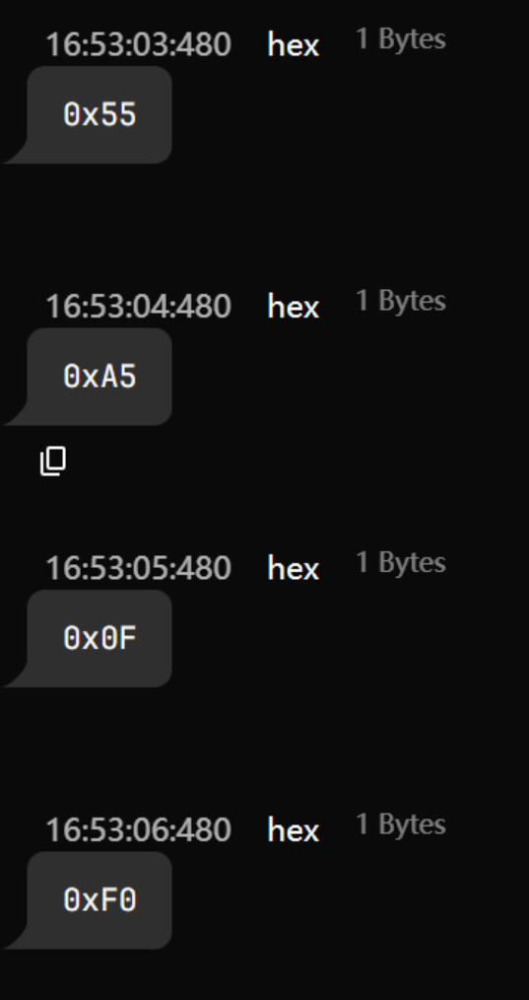

# FPGA UART 单字节发送模块

Verilog 实现的 UART 发送模块，参数化波特率，带 `Start` / `Tx_Done` 单拍握手。

## 硬件平台

- Xilinx Artix-7 `xc7a35tfgg484-2`（ACX720-V3 开发板）
- 系统时钟 50 MHz，波特率 9600 bps（8N1）

## 设计要点

- 10 位帧：1 起始位 + 8 数据位（**LSB first**）+ 1 停止位
- 波特率计数器 **5208 拍/位**（50,000,000 ÷ 9600 − 1）
- 输出 `Uart_Tx` 由位计数**组合译码**得到，不额外占用触发器
- `Start && !sending` 才允许装载数据，避免发送中途被新命令打断
- `Tx_Done` 由组合条件 `frame_end` 打一拍产生，**只宽一拍**

## 文件说明

| 文件 | 说明 |
|---|---|
| `uart_tx.v` | 发送模块本体（参数化 `CLOCK_FREQ` / `BAUD`） |
| `uart_tx_top.v` | 顶层：每秒发一个字节（0x55/0xA5/0x0F/0xF0 循环），LED 指示 |
| `uart_tx_tb.v` | 自检测试台：在每位中点采样 10 次，与标准答案逐位比对 |

## 验证结果

**仿真**（`uart_tx_tb.v`，自检式）：

- 连续发送 `0x55 / 0xA5 / 0x0F / 0x00 / 0xFF / 0x3C` 六个值
- 每个字节在**每一位的中点**采样 10 次，分别比对起始位（应为 0）、8 个数据位、停止位（应为 1）
- 六个值全部通过，打印 `===== PASS : all bytes sent correctly =====`

**上板**（ACX720-V3，串口助手 9600-8N1）：

- 每 **1.000 s** 稳定收到一个字节，顺序为 `55 → A5 → 0F → F0` 循环
- 1.000 s 的间隔证明分频计数器数满 50,000,000；字节能被正确解析证明一位 104.17 µs 准确

## 上板验证截图

串口助手（9600-8N1）每 1.000 s 稳定收到一个字节，顺序 `55 → A5 → 0F → F0` 循环：

## 遇到的问题

**1. 发送中途被新命令打断，导致整帧错乱**

最初写成 `else if (Send_Go) sending <= 1'b1;`，发送过程中若再次拉高 `Send_Go`，
`r_Data` 会被重新锁存 —— 结果是**前半帧是旧数据、后半帧是新数据**，接收方收到乱码。

改为 `else if (Send_Go && !sending)` 后，忙碌期间的新请求被忽略，副作用消失。

**2. 测试台死等，仿真卡住**

`wait (Tx_Done)` 到第 107 拍才执行，而 `Tx_Done` 只亮 20 ns，早已过去，导致仿真无限等待。
改为用触发器锁存事件：`reg done_seen; always @(posedge Clk) if (Tx_Done) done_seen <= 1'b1;`，
再 `wait (done_seen)`，并加 500 µs 超时保护。

> 结论：**单拍脉冲要么当场用掉，要么先锁存。**

## 时序与资源

- 全设计单一时钟域（50 MHz），无跨时钟域
- 无时序违例
