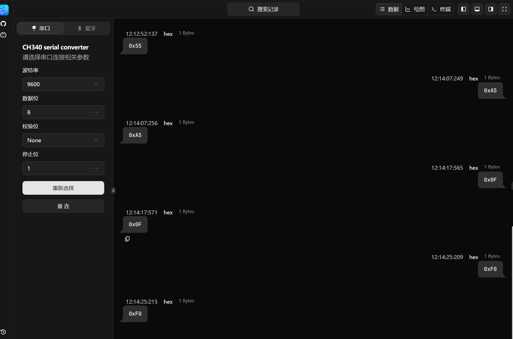

# FPGA UART 收发（Artix-7）

用 Verilog 写的 UART，包括发送、接收，以及一个接收后原样发回的回环顶层。
开发板是 ACX720-V3（xc7a35tfgg484-2），系统时钟 50 MHz，波特率 9600 8N1。

## 文件

| 文件 | 说明 |
|---|---|
| uart_tx.v | 发送，参数化的 CLOCK_FREQ / BAUD |
| uart_rx.v | 接收，带三拍同步和起始位校验 |
| uart_tx_top.v | 发送顶层，每秒发一个字节，LED 指示 |
| uart_rx_top.v | 回环顶层，收到的字节原样发回去 |
| uart_tx_tb.v | 发送的自检 testbench |
| uart_rx_tb.v | 接收的自检 testbench |
| uart_rx_top.xdc | 管脚约束 |

## 怎么跑仿真

1. 新建 Vivado 工程，器件选 xc7a35tfgg484-2
2. 把 uart_tx.v / uart_rx.v 加进 Design Sources
3. 把对应的 *_tb.v 加进 Simulation Sources
4. 右键 tb 文件 Set as Top，然后 Run All

tb 里的参数是改小的（比如 uart_rx_tb 用 CLOCK_FREQ=1600, BAUD=100，一位只有 16 拍），
所以几微秒就跑完，逻辑和上板时一样。

## 验证结果

**仿真**

两个 testbench 都是自检的：在每一位的中点采样，和期望值逐位比对，对不上就记一个错。
最后打印 PASS 或 FAIL 加错误条数。

```
[OK] 3191000 : got 55
[OK] 6391000 : got a5
[OK] 9591000 : got 0f
[OK] 12791000 : got f0
===== PASS : 4 bytes received correctly =====
```

0x0F 和 0xF0 是故意加的，这两个字节能抓出移位方向写反的问题。

**上板**

串口助手设 9600-8N1，发送模块每 1.000 秒收到一个字节，顺序 55 -> A5 -> 0F -> F0 循环。
回环顶层则是发什么回什么，发 0F 回 0F，发 F0 回 F0。

单发截图：


回环截图：



## 踩过的坑

**发送中途被打断**

一开始写的是 `else if (Send_Go)`，发送过程中再点一次发送，r_data 会被重新锁进去，
结果前半帧是旧数据、后半帧是新数据，收方拿到的是乱码。
改成 `Send_Go && !sending` 之后，忙的时候直接忽略请求就好了。

**testbench 死等**

最早用 `wait (Tx_Done === 1)` 等发完，但 Tx_Done 只有一拍，采样循环走回来的时候它早就过去了，
仿真就卡在那儿不动。后来加了个 done_seen 把它记住，再 wait 这个标志，另外挂了个超时保护。

**连发两个字节只回一个**

回环的时候如果连着发两个字节，第二个经常丢掉。原因是收发之间没有 FIFO，
发送一帧要 1.04 ms，这期间收到的字节没有地方存，就被丢了。
要支持连续收发的话，中间得加一级 FIFO。

## 资源

50 MHz 单一时钟域，没有跨时钟域。综合后无时序违例。
